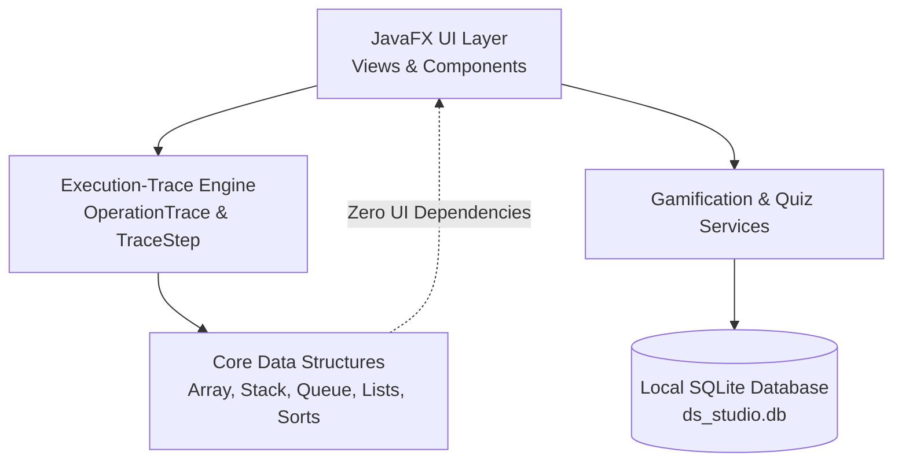

# DS Studio — Interactive Data Structures Learning & Visualization Platform

> **Tagline:** *Learn It. Visualize It. Code It. Master It.*  
> **Target Audience:** BSc Computer Science, BCA, MCA, and Engineering students.  
> **Course Suitability:** Data Structures and Advanced Data Structures mini-project & viva demonstration.

---

## 1. Project Overview & Vision
**DS Studio** is a native Java desktop application designed to bridge the gap between abstract computer science data structure concepts and real code execution. 

Unlike static textbooks or generic CRUD apps, **DS Studio** combines:
1. **Interactive Visualizer Lab:** Step-by-step operation animations powered by immutable execution-trace snapshots.
2. **Synchronized Java Code Lab:** Line-by-line active code highlighting synchronized with diagram state changes.
3. **DS Quest & Practice Centre:** Gamified quest categories (Concept, Output Prediction, Debugging, Dry Run Tracing, and Big-O Complexity).
4. **Examination Quiz Centre:** Timed and practice modes with a question palette, review flags, and local performance tracking.
5. **Local Offline Persistence:** SQLite database caching user progress, XP, learning streaks, badges, and quiz attempts with zero internet dependency.

---

## 2. Architecture & Design Principles



### Decoupled Execution-Trace Architecture
- **Pure Algorithm Implementations:** Standalone Java classes (`ArrayStructure`, `StackStructure`, `QueueStructure`, `CircularQueueStructure`, `SinglyLinkedListStructure`, `DoublyLinkedListStructure`, `CircularLinkedListStructure`, and `SortingAlgorithms`).
- **Granular Snapshots (`TraceStep`):** Every operation generates an immutable list of micro-steps detailing element shifts, pointer mutations (`HEAD`, `TAIL`, `TOP`, `FRONT`, `REAR`), code lines, and asymptotic bounds.
- **Visualizer Engine:** Consumes trace steps and animates canvas shapes with playback controls (`Play`, `Pause`, `Step Next`, `Step Prev`, `Reset`, and `Speed Slider`).

---

## 3. Technology Stack & Verification
- **Language:** OpenJDK 21 LTS (Eclipse Temurin 21.0.6)
- **UI Framework:** JavaFX 21.0.6 (Controls, Graphics, FXML, Custom Obsidian Dark Theme)
- **Database:** SQLite 3.45.2.0 via JDBC (`~/.dsstudio/ds_studio.db`)
- **Build System:** Apache Maven 3.9.9
- **Automated Testing:** JUnit Jupiter 5.10.2 (10/10 tests passing)

---

## 4. Package & Directory Structure
```
d:\ads\
├── pom.xml
├── run.bat
├── src
│   ├── main
│   │   ├── java
│   │   │   └── com\dsstudio\
│   │   │       ├── DSStudioApp.java              # JavaFX Entrypoint & View Router
│   │   │       ├── core\
│   │   │       │   ├── structures\
│   │   │       │   │   ├── algorithms\
│   │   │       │   │   │   └── SortingAlgorithms.java
│   │   │       │   │   └── linear\
│   │   │       │   │       ├── ArrayStructure.java
│   │   │       │   │       ├── StackStructure.java
│   │   │       │   │       ├── QueueStructure.java
│   │   │       │   │       ├── CircularQueueStructure.java
│   │   │       │   │       ├── SinglyLinkedListStructure.java
│   │   │       │   │       ├── DoublyLinkedListStructure.java
│   │   │       │   │       └── CircularLinkedListStructure.java
│   │   │       │   └── trace\
│   │   │       │       ├── OperationTrace.java
│   │   │       │       ├── StepType.java
│   │   │       │       └── TraceStep.java
│   │   │       ├── db\
│   │   │       │   └── DatabaseManager.java       # SQLite Connection & Auto Schema
│   │   │       ├── model\
│   │   │       │   └── Question.java
│   │   │       ├── repository\
│   │   │       │   └── QuestionRepository.java    # Curated Question Bank
│   │   │       ├── service\
│   │   │       │   ├── GamificationService.java   # XP, Levels & Achievements
│   │   │       │   └── LessonService.java         # Academic Curriculum & Viva QA
│   │   │       └── ui\
│   │   │           ├── components\
│   │   │           │   ├── HeaderBar.java
│   │   │           │   └── SidebarNav.java        # 13 Navigation Sections
│   │   │           └── views\
│   │   │               ├── DashboardView.java
│   │   │               ├── LearnView.java
│   │   │               ├── VisualizerLabView.java
│   │   │               ├── CodeLabView.java
│   │   │               ├── DSQuestView.java
│   │   │               ├── PracticeCenterView.java
│   │   │               ├── QuizCenterView.java
│   │   │               ├── AlgorithmsView.java
│   │   │               ├── ComplexityGuideView.java
│   │   │               ├── BookmarksView.java
│   │   │               ├── ProgressView.java
│   │   │               ├── SettingsView.java
│   │   │               └── AboutView.java
│   │   └── resources\
│   │       └── css\
│   │           └── dark-theme.css                 # Obsidian & Electric Indigo Design
│   └── test
│       └── java
│           └── com\dsstudio\core\structures\
│               ├── algorithms\SortingAlgorithmsTest.java
│               └── linear\LinearStructuresTest.java
```

---

## 5. How to Run & Test

### Run Application:
Simply run the included batch launcher or Maven:
```cmd
.\run.bat
```
Or via Maven:
```powershell
$env:JAVA_HOME = "C:\tools\jdk-21.0.6+7"
$env:PATH = "$env:JAVA_HOME\bin;C:\tools\apache-maven-3.9.9\bin;$env:PATH"
mvn javafx:run
```

### Run Automated Unit Tests:
```powershell
mvn test
```

### Test Outcomes:
```
[INFO] Running com.dsstudio.core.structures.algorithms.SortingAlgorithmsTest
[INFO] Tests run: 3, Failures: 0, Errors: 0, Skipped: 0
[INFO] Running com.dsstudio.core.structures.linear.LinearStructuresTest
[INFO] Tests run: 7, Failures: 0, Errors: 0, Skipped: 0
[INFO] BUILD SUCCESS (10/10 tests passed)
```

---

## 6. Viva Demonstration Guide for MCA Mini-Project
1. **Explain the Architecture:** Emphasize that the UI does not compute or fake algorithms; the core Java data structures execute the actual algorithmic transitions and return snapshot traces.
2. **Demonstrate Edge Cases:**
   - Stack Overflow (`capacity reached`) & Underflow (`top == -1`).
   - Circular Queue wrap-around: show `(rear + 1) % capacity` modulo index wrapping.
   - Array shifts during index insertion/deletion.
   - Linked List pointer reconnection without memory leaks or cyclical head loss.
3. **Highlight DS Quest & Gamification:**
   - Walk through the output prediction, debugging question, and dry run modes.
   - Show SQLite database updating XP and unlocked badges immediately in the Progress dashboard.
